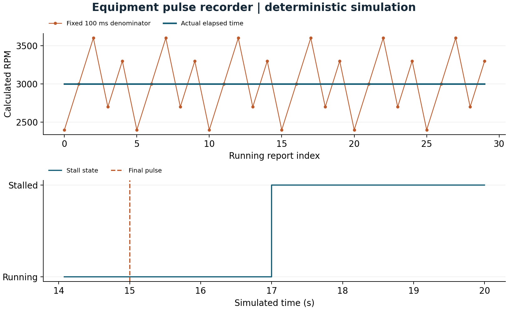
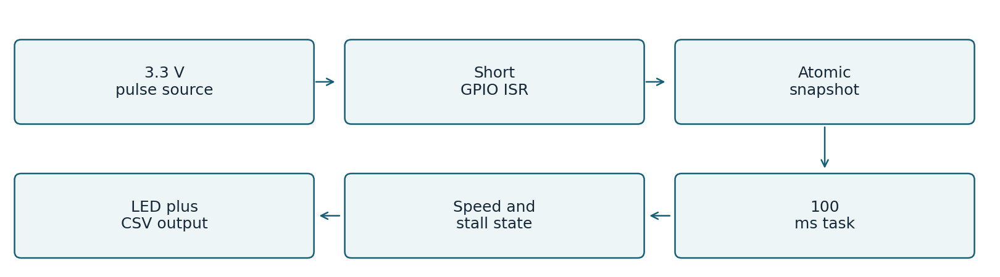

# Equipment pulse recorder

Measure pulse-derived equipment speed with short interrupts, actual elapsed-time normalization, persistent configuration and rollover-safe stall detection.

**Verified:** ESP32 target compilation, portable C++ tests, deterministic fault simulations and host benchmarks. **Physical board testing is pending.** Development was AI-assisted. These results demonstrate a reproducible prototype and do not establish field reliability or independent professional experience.



## Comparable results

| Metric | Baseline B0 | Improved R1 | Unit |
|---|---:|---:|---|
| Speed normalization error | 360 | 0 | RPM |

B0 and R1 are explicitly implemented algorithm variants run on the same workload in `tools/simulate.cpp`, not fabricated historical releases. See [metric definitions, workloads and limitations](evidence/metrics.json). Null baselines mean no comparison was measured. Host throughput is not microcontroller throughput; static linker RAM excludes runtime allocations.

## Run without hardware

Requires C++17, Python 3.9+ and a POSIX shell (macOS/Linux, or WSL on Windows). From this directory:

```sh
sh tools/test.sh
sh tools/sanitize.sh
sh tools/simulate.sh > evidence/trace.csv
python3 tools/replay_failure.py
```

The sanitizer run requires a compiler supporting AddressSanitizer and UndefinedBehaviorSanitizer. The simulator shares portable headers with the firmware; it does not emulate the ESP32 or FreeRTOS.

## Rebuild firmware and measurements

```sh
python3 -m venv .venv
.venv/bin/pip install -r tools/requirements.txt
.venv/bin/pio run -e esp32dev -e simulated
.venv/bin/python tools/benchmark.py --rerun
.venv/bin/python tools/figures.py
```

PlatformIO Core 6.1.18, Espressif32 platform 6.9.0, Arduino ESP32 2.0.17 and Xtensa GCC 8.4.0 are pinned. First build downloads the toolchain. `esp32dev` uses physical inputs; `simulated` generates input **on an ESP32** and still needs a board to run. The host simulation above needs no board. Recorded firmware images and ELF files are in `firmware/`, with exact build logs in `evidence/`.

With the specified board wired, select the actual serial port:

```sh
.venv/bin/pio run -e esp32dev -t upload --upload-port PORT
.venv/bin/pio device monitor --port PORT -b 115200
```

No upload was performed during this project. Check board model, common ground and 3.3 V signal levels before connecting peripherals.

## Engineering evidence and walkthrough

- [Technical report PDF](docs/technical-report.pdf), [editable Word report](docs/technical-report.docx), [Markdown](docs/technical-report.md)
- [Hardware, BOM, wiring and required instruments](docs/hardware.md)
- [Requirements and acceptance targets](docs/requirements.md), [test matrix](evidence/test-matrix.csv)
- [Failure log and corrective actions](docs/failures.md), [original test output](evidence/initial-tests.txt)
- [Resource budgets, FMEA and release gates](docs/engineering-review.md)
- [Mentor guide: code walkthrough, demo, ten interview answers and exercises](docs/mentor-guide.md)
- [References and implementation attribution](docs/references.md)



`src/main.cpp` owns target peripherals; `include/` contains testable drivers and logic; `tests/` exercises that logic and injected faults; `tools/` generates traces, benchmarks and reports. Framework libraries provide the HAL, FreeRTOS, NVS and sleep services. Project code provides the application policy and custom drivers.

## Troubleshooting and next experiments

If the serial port is missing, use a data-capable USB cable and verify the board's USB bridge driver. If a host test fails, retain its exact output before changing code. If a sensor faults, check the wiring diagram, sensor identity/address and bus signals with a logic analyzer. A compile success does not verify electrical operation.

The report lists specific board experiments for timing, watchdog resets, power interruption and sensor/link failures. The environmental project additionally requires current profiling before any battery-life claim; the pulse project requires a known pulse source before RPM accuracy claims. No hardware acceptance test is marked passed based on simulation.

To regenerate the editable report, install `python-docx==1.2.0` and run `python3 tools/report.py`; PDF export also needs a Word-compatible renderer. Inspect every exported page after changes.
