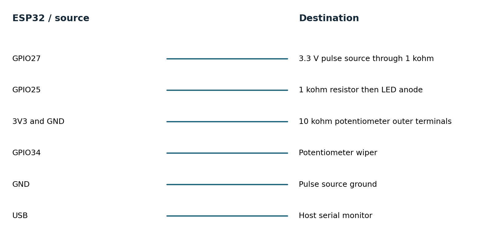

# Equipment pulse recorder hardware guide

No hardware was connected. This design is ready for a later bench build. Use a classic ESP32-WROOM DevKitC; GPIO16/17 can be unavailable on WROVER variants.

## Bill of materials

| Component | Qty | Cost |
|---|---|---|
| ESP32 DevKitC WROOM 4 MB | 1 | USD 10-18 estimate |
| 10 kohm pot, LED, 1 kohm resistors, wires | 1 set | USD 5-10 estimate |
| Second ESP32 or function generator | 1 | Borrow or USD 10-18 board estimate |

Costs are USD planning estimates except the cited sensor prices observed on 2026-11-11. Tax, shipping, computer and test equipment are excluded. One board can be reused across the portfolio.

## Wiring

| ESP32 or source | Destination | Notes |
|---|---|---|
| GPIO27 | 3.3 V pulse source through 1 kohm | Common ground; never 5/12/24 V directly |
| GPIO25 | 1 kohm resistor then LED anode | LED cathode to GND |
| 3V3 and GND | 10 kohm potentiometer outer terminals | Low-voltage ADC stimulus |
| GPIO34 | Potentiometer wiper | ADC1 input; raw counts only |
| GND | Pulse source ground | Required common reference |
| USB | Host serial monitor | 115200 baud; PPR commands |

Use 3.3 V signaling, short leads and a common ground. Do not connect GPIOs directly to mains equipment or industrial 5/12/24 V outputs. Start with a bench pulse source or isolated low-voltage rig. Use USB power for initial bring-up; battery charging and protection are outside this prototype.

## Tools for physical validation

- Required for assembly: data-capable USB cable, breadboard/jumpers, multimeter; soldering tools if breakout headers are not fitted.
- Required for timing claims: logic analyzer with at least 10 MHz sampling for 2 MHz SPI; 20 MHz or more is preferable.
- Required for pulse fidelity: calibrated function generator or second MCU, checked with a logic analyzer.
- Required for power claims: current profiler or suitable shunt plus oscilloscope, bench supply and a measured battery specification.
- Optional firmware debugging: ESP-Prog JTAG adapter; serial diagnostics suffice for the initial experiments.

## Acceptance experiments

1. Drive GPIO27 with 10, 100 and 1000 Hz 3.3 V square waves for 60 s each. Compare accepted counts with a generator or logic analyzer. Add narrow bounce pulses <500 microseconds and confirm rejection without suppressing valid edges.

2. Capture a diagnostic GPIO toggled at each report along with the input pulses for 10 minutes. Compute actual interval p50/p95/p99 and missed periods; target p99 jitter <5 ms. Stop pulses at randomized phases and verify LED latency <=2.1 s.

3. Change PPR while stopped, reboot and verify persistence; cut power during configuration writes. Compare ADC raw counts at measured 0.5, 1.0, 2.0 and 3.0 V inputs. Disable watchdog feeding in a temporary test build and verify reset.
