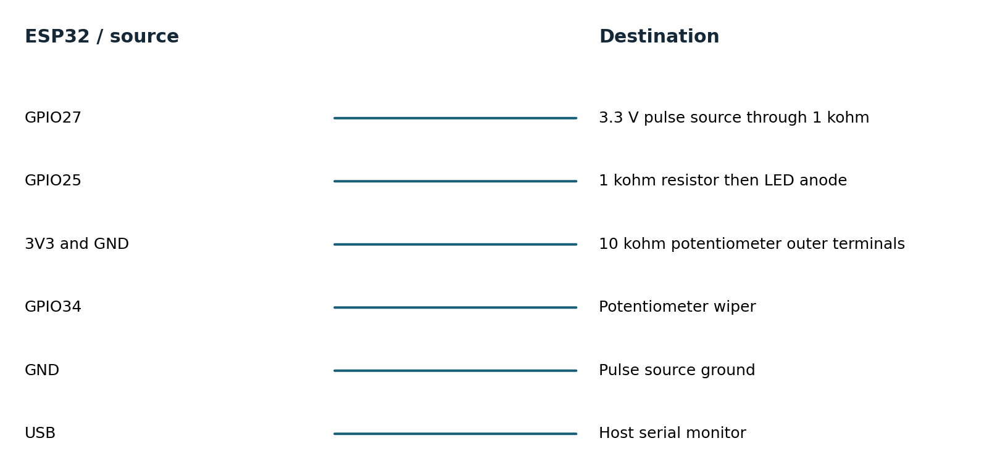
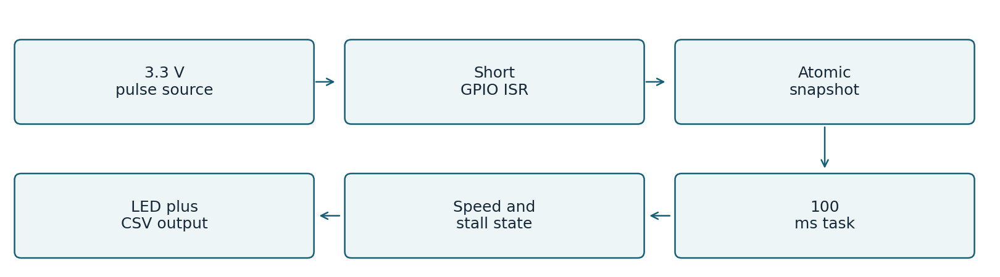
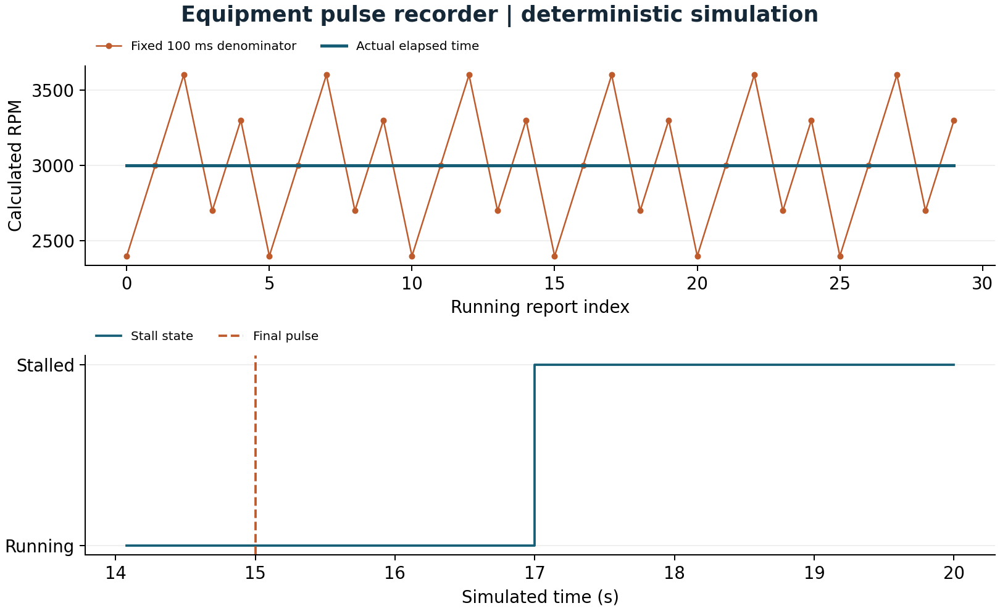

# Equipment pulse recorder

Speed and stall monitoring with bounded interrupt work

Equipment pulse recorder

Speed and stall monitoring with bounded interrupt work

Engineering report  |  11 November 2026  |  AI-assisted implementation

A lab operator needs speed, running-time estimates and a clear stalled indication from a low-voltage fan or test fixture. This recorder counts digital pulses, reports speed at 100 ms intervals and lights an LED after two seconds without a pulse. It is a monitor, not a machine safety controller.

Verified scope: portable C++ tests and deterministic simulations, host integration where applicable, and actual ESP32 cross-compilation. No board was flashed, sensor exercised, or physical measurement collected.

## Requirements and acceptance

| ID | Target established before testing | Verification status |
| --- | --- | --- |
| P1 | GPIO27; <=1 kHz; reject edges <500 us; short ISR | Debounce model passes; real pulse fidelity pending |
| P2 | 100 ms reports; 2 s stall; PPR 1..32 | Counter/time wrap and stall simulation pass |
| P3 | Bounded PPR command; version/CRC persistence | Parser and corruption tests pass |
| P4 | ADC1 GPIO34 raw samples; LED GPIO25 | Compiled adapter; electrical test pending |
| P5 | p99 report jitter <5 ms; 5 s watchdog | Target measurements pending |

Targets remain targets until their corresponding environment is tested. This report distinguishes synthetic behavior, host wall-clock execution and linker resource counts. Hardware timing, current, electrical recovery and watchdog reset remain pending.

## Hardware and wiring

Target: classic ESP32-WROOM-32 DevKitC with 4 MB flash. One board can be reused across the three projects. Use the specified 3.3 V interfaces; WROVER pin availability differs.

| Component | Qty | Planning cost |
| --- | --- | --- |
| ESP32 DevKitC WROOM 4 MB | 1 | USD 10-18 estimate |
| 10 kohm pot, LED, 1 kohm resistors, wires | 1 set | USD 5-10 estimate |
| Second ESP32 or function generator | 1 | Borrow or USD 10-18 board estimate |

Sensor prices were observed on the cited supplier pages on 11 November 2026. Other costs are estimates in USD, excluding tax, shipping and measurement instruments.

Connection diagram names signal endpoints, not physical header positions. Consult the board silk screen. Use a common ground and short leads. Start with a low-voltage bench setup; industrial-voltage inputs need a suitable interface. See hardware.md for pin notes and instrument requirements.

## Firmware architecture and decisions

The ISR uses the ESP timer timestamp and a critical section around its counter/timestamps. Its debounce timestamp is 64-bit to avoid rejecting a first pulse after a very long idle because of 32-bit aliasing. The reporting task takes the same lock only while copying fields; formatting and ADC reads happen outside it.

Speed uses modular count difference and actual elapsed microseconds. The calculation assumes snapshots occur more frequently than one 32-bit timer wrap, which is satisfied by the 100 ms target. The 1 kHz limit also prevents ambiguity from a full count wrap between reports.

Idle age accumulates between snapshots and saturates at two seconds. A changed count resets age from the latest edge. Once stalled, the output remains stalled until a new pulse is observed, even through repeated microsecond timer wraps.

PPR changes are parsed from a 32-byte bounded line, constrained to 1..32, CRC-sealed and committed to NVS before replacing the live value. Writes are rate-limited to once per second. A PPR change applies at the next report and may affect that boundary interval; perform calibration while stopped.

Runtime is accumulated for reporting intervals whose latest pulse is within the stall timeout. It includes the timeout tail, and is not exact shaft-on time. ADC1 avoids the ADC2/radio restriction but is still uncalibrated; output is raw ADC counts, never fabricated volts.

### Ownership of the implementation

Project code implements drivers, calculations, state machines, queue/parser policy, tests and tools. Arduino ESP32 provides the peripheral HAL and startup; ESP-IDF provides FreeRTOS, NVS, watchdog and sleep services. The environmental gateway uses SQLite transactions. Official GitHub drivers were studied as references; they were not copied into these custom headers.

## Testing and evidence

| Requirement | Test or experiment | Result |
| --- | --- | --- |
| P1 | 500 us debounce boundary and wrapped timestamps | PASS host model |
| P2 | Counter rollover, elapsed rollover, zero interval, no-pulse startup | PASS host |
| P2 | 90,000 reports covering two timer wraps while stopped | PASS host regression |
| P3 | Invalid numbers, oversized commands, config corruption and reload | PASS host |
| P2 | Deterministic +/-20 percent interval jitter and stop trace | PASS simulation |
| P1/P4/P5 | Real pulse capture, ADC linearity, ISR latency, watchdog, NVS power cut | PENDING hardware |

Host tests compile the same portable headers used by target firmware. Strict compiler warnings, AddressSanitizer and UndefinedBehaviorSanitizer are enabled in separate test runs. Bus mocks validate transactions and selected faults; they do not reproduce analog behavior or peripheral timing.

PASS 90130 assertions: debounce, rollover, long idle, parser, configuration

Recorded extended loop: 60.000048 seconds and 27,442,510,000 workload iterations. This is one short host stress run, not a field endurance qualification. Three additional approximately five-second repetitions provide throughput variability.

Evidence is retained in tests.txt, sanitizers.txt, trace.csv, soak.json, extended-soak.json and build logs. test-matrix.csv maps requirements to results. Original failures remain in initial-tests.txt. No hardware test is marked passed on the strength of a simulation.

## Baseline and improved performance

| Metric | Baseline | Improved | Unit |
| --- | --- | --- | --- |
| Speed normalization error | 360 | 0 | RPM |
| Stall delay | Not measured | 2 | s |

Mean normalization error falls from 360 to 0 RPM on the phase-aligned synthetic trace. The zero is specific to the constructed input and elapsed-time arithmetic; it is not a physical RPM accuracy claim. Stall appears 2.0 simulated seconds after the final pulse. Real low-speed quantization and scheduling jitter remain.

## Measurement definitions and limitations

### M06 Speed normalization error

Definition: Mean absolute RPM error. Method: Fixed 100 ms vs measured elapsed interval on same counts. Workload: 3000 RPM; 2 PPR; repeated 80/100/120/90/110 ms schedule. Samples: 150 running intervals.

Environment: deterministic host simulation of shared C++ logic. Baseline: 360; improved: 0 RPM. Limits: Ideal phase-aligned integer pulse counts; real quantization remains.

### M07 Stall delay

Definition: First stalled report minus final pulse timestamp. Method: Read timestamp difference from stopped trace. Workload: Pulse train ends after step 149. Samples: 50 stopped intervals.

Environment: deterministic host simulation of shared C++ logic. Baseline: Not measured; improved: 2 s. Limits: No baseline stall algorithm; simulation time only; target <=2.1 s.

### Resource counts and host execution

M08 Firmware flash footprint: 290,001 bytes. Parse target linker size report. 1 target build. Baseline: not measured. No baseline firmware image; static RAM excludes runtime heap, queues and task stacks.

M09 Firmware static RAM: 22,384 bytes. Parse target linker size report. 1 target build. Baseline: not measured. No baseline firmware image; static RAM excludes runtime heap, queues and task stacks.

M10 Host core throughput: 452,102,244.3061 units/s. steady_clock around compiled C++ core; observable checksum. 3 repetitions, durations 5.000026s,5.000019s,5.000022s. Baseline: not measured. Desktop benchmark only; no baseline speedup claim; min=447311666.55396026 max=458775954.68503886.

Target build: Xtensa GCC 8.4.0, Arduino ESP32 2.0.17 and PlatformIO Espressif platform 6.9.0. Host: macOS-26.2-arm64-arm-64bit; C++17 -O2; portable application core. The complete nine-field metric records and machine-readable values are in evidence/metrics.csv and metrics.json. Physical latency, stack use, CPU load, current and battery life are not reported as measured.

## Failures recovery and remaining risks

### Observed failures and review fixes

The first long-idle regression failed: direct subtraction from an old edge made the stopped device appear recently active after a timer wrap. A saturating idle-age accumulator fixed it; 90,000 report intervals now cover more than two wraps. Review also changed the ISR debounce timestamp to 64-bit. The model and physical adapter timing remain separately identified.

### Current limitations

Speed is quantized by pulses per reporting window, especially at low RPM. The synthetic jitter test uses pulse counts that divide cleanly into its intervals; real edge phase adds quantization. Debounce can reject legitimate pulses closer than 500 microseconds, so the supported rate is deliberately limited to 1 kHz. Runtime includes a timeout tail. The LED is not a safety output. ADC voltage and sample timing require calibration and measurement.

### Hardware acceptance experiments

1. Drive GPIO27 with 10, 100 and 1000 Hz 3.3 V square waves for 60 s each. Compare accepted counts with a generator or logic analyzer. Add narrow bounce pulses <500 microseconds and confirm rejection without suppressing valid edges.

2. Capture a diagnostic GPIO toggled at each report along with the input pulses for 10 minutes. Compute actual interval p50/p95/p99 and missed periods; target p99 jitter <5 ms. Stop pulses at randomized phases and verify LED latency <=2.1 s.

3. Change PPR while stopped, reboot and verify persistence; cut power during configuration writes. Compare ADC raw counts at measured 0.5, 1.0, 2.0 and 3.0 V inputs. Disable watchdog feeding in a temporary test build and verify reset.

The engineering-review.md companion records resource budgets, failure modes and release gates. A change should update its requirements, test matrix and comparison trace together; preserve the original workload so before/after values remain comparable.

## Reproduce demonstrate and explain

Prerequisites: C++17 compiler, Python 3.9 or later, and a terminal. The simulation and C++ tests require no board or paid service. From the project directory:

    sh tools/test.sh
    sh tools/sanitize.sh
    sh tools/simulate.sh > evidence/trace.csv
    python3 -m venv .venv
    .venv/bin/pip install -r tools/requirements.txt
    .venv/bin/python tools/benchmark.py --rerun
    .venv/bin/python tools/figures.py
    .venv/bin/pio run -e esp32dev -e simulated
On Windows, activate the virtual environment and use its Scripts executables; run shell scripts through WSL or a compatible shell. Flash only when the matching board is attached: pio run -e esp32dev -t upload --upload-port PORT. Use pio device monitor --port PORT -b 115200. The simulated firmware environment generates inputs on a physical ESP32; the host simulator runs on the computer.

### Demonstration sequence

1. Run sh tools/test.sh; point out the long-idle regression and malformed-command checks.

2. Run sh tools/simulate.sh and inspect the jitter comparison chart.

3. Show why 80 ms and 120 ms intervals fool the baseline but not elapsed-time normalization.

4. Follow the stopped trace to STALLED, then state that real jitter and pulse-loss claims await a generator.

The mentor-guide.md companion contains a beginner explanation, code walkthrough, ten interview questions with answers, independent exercises and three evidence-based resume bullets. Development was AI-assisted; no independent hardware work or production deployment experience is implied.

### Primary references

ADXL345 Rev G datasheet: https://www.analog.com/media/en/technical-documentation/data-sheets/adxl345.pdf

SHT3x DIS version 7 datasheet: https://sensirion.com/media/documents/213E6A3B/63A5A569/Datasheet_SHT3x_DIS.pdf

ESP32 DevKitC guide: https://docs.espressif.com/projects/esp-idf/en/v4.4.7/esp32/hw-reference/esp32/get-started-devkitc.html

ESP32 watchdog API: https://docs.espressif.com/projects/esp-idf/en/v4.4.7/esp32/api-reference/system/wdts.html

Pinned platform definition: https://github.com/platformio/platform-espressif32/blob/v6.9.0/platform.json

See references.md for the pinned GitHub driver study, supplier links and implementation attribution.

